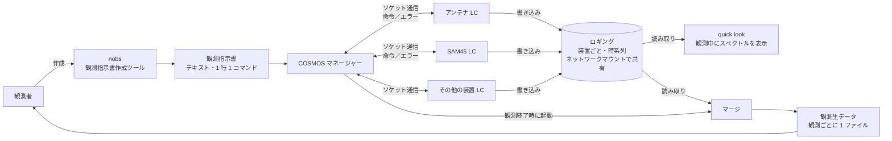

# 45m 観測の流れ（COSMOS）

野辺山 45m で、観測指示書から観測生データができるまでの流れ。**既存のシステムの構成**だけを書く。
YATSUGATAKE で SAM45 を肩代わりするための検討は [`../design/standin-study.md`](../design/standin-study.md) に分けてある。

> 出典: 西村さんからの聞き取り（2026-11-06）。
> 既存のシステムについて新しくわかったことは、ここに追記する。

## 全体の流れ

## わかっていること

### 1. 観測指示書

- 観測者が作る。今の作成ツールは **nobs**。
- nobs は近いうちに大幅に改修し、別のソフトに置き換える予定。**観測指示書のフォーマットは変えない予定。**
- テキストで、**1 行に 1 コマンド**。1 行目から順に実行される。
- 命令は**装置ごと**に書かれる。

### 2. COSMOS マネージャー

- 観測指示書を読み込み、装置ごとの命令をその装置に送る。
- 送る先は、各装置に置かれた **Local Controller（LC）**。LC は共通の規格で、通信は**ソケット通信**。
- 例: アンテナ LC にアンテナの駆動を指示し、SAM45 LC に分光のパラメータを設定してから、分光の開始・終了のタイミングを指示する。
- 観測が終わったら、マージを起動する。

### 3. Local Controller（LC）

- 個別の装置を制御する。
- エラーが起きたら COSMOS マネージャーに返す。
- 装置の動作記録（**ロギング**）をディスクに保存する。

### 4. ロギング

- 時系列で、装置ごとの情報を持つ（例: アンテナの向き、分光計のスペクトル）。
- **ネットワークマウント**で、ほかの計算機と共有される。
- 観測者は、通常はロギングに直接アクセスしない。

### 5. quick look（QL）

- 観測中、観測者がスペクトルをリアルタイムに確認するための機能。
- **ロギングを読み取って**可視化する。

### 6. マージ

- 観測終了時に COSMOS マネージャーが起動する。
- 各装置のロギングを読み取り、**観測ごとに 1 つのファイル**として観測生データを作る。
- 観測者は通常、この観測生データを取得して解析する。
