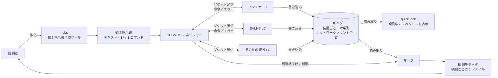

# 45m 観測の流れ（COSMOS）

野辺山 45m で、観測指示書から観測生データができるまでの流れ。**既存のシステムの構成**だけを書く。
YATSUGATAKE で SAM45 を肩代わりするための検討は [`../design/standin-study.md`](../design/standin-study.md) に分けてある。

> 出典: 西村さんからの聞き取り（2026-11-06）。
> 既存のシステムについて新しくわかったことは、ここに追記する。

## 全体の流れ

## わかっていること

### 1. 観測指示書

- 観測者が作る。今の作成ツールは **nobs**。観測者は指示書の変換スクリプトにはアクセスできる。
- nobs は近いうちに大幅に改修し、別のソフトに置き換える予定。**観測指示書のフォーマットは変えない予定。**
- テキストで、**1 行に 1 コマンド**。1 行目から順に実行される。
- 命令は**装置ごと**に書かれる。
- 指示書の機能に **MLPPS**（シェルコマンドの実行）がある。これで python のコードも実行できる（2026-11-06）。

### 2. COSMOS マネージャー

- 観測指示書を読み込み、装置ごとの命令をその装置に送る。
- 送る先は、各装置に置かれた **Local Controller（LC）**。LC は共通の規格で、通信は**ソケット通信**。
- 例: アンテナ LC にアンテナの駆動を指示し、SAM45 LC に分光のパラメータを設定してから、分光の開始・終了のタイミングを指示する。
- 観測が終わったら、マージを起動する。
- 通常の LC とは、LC の状態を常にやりとりしており、観測中の装置の異常をすぐに検出できる。
  MLPPS で実行したコマンドからは、実行時の返り値でしか状態を受け取れない（2026-11-06）。
- マネージャーを改修するには COSMOS 全体の再コンパイルが要る（2026-11-06）。

### 3. Local Controller（LC）

- 個別の装置を制御する。
- エラーが起きたら COSMOS マネージャーに返す。
- 装置の動作記録（**ロギング**）をディスクに保存する。

### 4. ロギング

- 時系列で、装置ごとの情報を持つ（例: アンテナの向き、分光計のスペクトル）。
- **ネットワークマウント**で、ほかの計算機と共有される。
- 観測者は、通常はロギングに直接アクセスしない。
- **ロギングのファイルは観測の開始時にできる。** SAM45 のロギングでは、ヘッダに分光の設定が全部入っている（2026-11-06）。
- ロギングのファイルができてから最初のスペクトルの観測まで、観測全体のセットアップで **≒ 30 s** かかる（2026-11-06）。

### 5. quick look（QL）

- 観測中、観測者がスペクトルをリアルタイムに確認するための機能。
- **ロギングを読み取って**可視化する。

### 6. マージ

- 観測終了時に COSMOS マネージャーが起動する。
- 各装置のロギングを読み取り、**観測ごとに 1 つのファイル**として観測生データを作る。
- 観測者は通常、この観測生データを取得して解析する。
- マージのスクリプトには、観測者はアクセスできない（2026-11-06）。

### 7. SAM45

- IF 入力は 16 本で、各入力を Array（A01〜A16）と呼ぶ。1 つの IF 入力に窓（SpW）を最大 2 つ設定でき、2 つ目の窓は A17〜A32（A_n の 2 つ目が A_(n+16)）。
- 積分時間は **40 ms・100 ms** に対応している（2026-11-06）。PSW の積分時間は秒の単位（整数）で、**PSW の観測は 1PPS の秒の境界から始まる**（2026-11-06）。
- **4 GSPS で、第 2 ナイキストの 2〜4 GHz を入力する。** 524,288 点の分光から、窓（SpW）ごとに `istart_chan`〜`iend_chan` を `ichan_avg` 個ずつ束ねて 4096 ch を出す。窓は任意に 2 つ取れる。SpW を 1 つだけ使う non-SpW モードでは、IF 3 GHz で入力する（2026-11-06）。
- 受信機の出力の 1st IF（ロギングの `dflif`）の後にも、ミキサなどの IF 系が続き、SAM45 には 2〜4 GHz で入る（2026-11-06）。
- ADC は 3 bit でダイナミックレンジが狭い。観測の始めに SKY でレベルを合わせ、R のときはプログラマブル ATT（**IFATT**）を足してレベルを下げる。R で何 dB 足すかは観測者が指示書で決め、ロギングの `iary_ifatt` に入る（2026-11-06）。
- QL・マージは、ロギングの `dtsys` を参考値として表示する（2026-11-06）。
- **サブアレイ**: A01〜A08 と A09〜A16（2 つ目の窓は A17〜A24 と A25〜A32）をそれぞれサブアレイと呼び、サブアレイごとに帯域（周波数分解能）を変えられる。サブアレイごとに帯域を変えるモード（ロギングの `csub_array` が ON）は運用で使われている（2026-11-06）。
- IF 系は、SAM45 の別の Array に同じ IF を入れられるように作られており、そういう周波数の設定で運用した経験もある（2026-11-06）。
- ロギングの形式は [`sam45-logging.md`](sam45-logging.md)。
- 2026-11 現在、**A05〜A08・A21〜A24 が故障している**。SAM45 のロギングには A05〜A08・A21〜A24 が含まれない（2026-11-10）。
