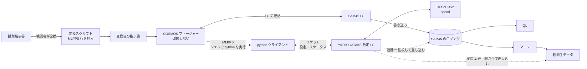

# SAM45 の肩代わりの検討

YATSUGATAKE で SAM45 の故障した Array（A05〜A08、A21〜A24）を肩代わりするための検討と、決めたこと。
既存のシステムの構成（観測指示書 → COSMOS マネージャー → LC → ロギング → QL・マージ）は
[`../cosmos/observation-flow.md`](../cosmos/observation-flow.md) にあり、ここではそれを前提にする。

## 優先度（2026-11-06 決定）

1. **スピード。** SAM45 はすでに故障しているので、できるだけ早く実装を終える。
2. **観測者の手順の変更を最小にする。** 多少の変更（変換スクリプトを手で実行する程度）は許容する。

## 決めたこと（2026-11-06）

| 項目 | 決定 | 理由 |
|---|---|---|
| マネージャー | **改修しない** | 改修には COSMOS 全体の再コンパイルが要り、リスクがある |
| 命令の受け取り | **MLPPS で暫定 LC に送る**（下の b4） | マネージャーを変えずに済み、最も早く作れる |
| 指示書への MLPPS の挿入 | **変換スクリプトで自動で挿入する** | 観測者の手間を「指示書に変換スクリプトをかけるだけ」にする。SAM45 の設定と YATSUGATAKE の設定がずれないよう、SAM45 の行から作る |
| スペクトルの差し込み | **SAM45 のロギングを監視し、YATSUGATAKE のスペクトルを差し込む**（下の c4） | SAM45 が実際に積分した時刻をそのまま使え、開始・終了のタイミングを指示書で伝えずに済む |
| 進め方 | **2 段階**。段階 1 は運用側の動作試験、すぐ続けて段階 2 で本番の形にする | マージは観測者からアクセスできないので、マージ後の手作業は観測者に任せられない。段階 1 は運用側で回す |
| 積分時間のずれ | **許容する** | SAM45 は 40 ms・100 ms、YATSUGATAKE は 40.96 ms 単位。このずれは科学観測上は問題にならない |
| 状態の監視 | **MLPPS の返り値で確認する**（下の「状態の監視」） | 観測中の異常は次の MLPPS での検出になるが、ステータス確認の MLPPS をある程度の間隔で入れれば大きな問題ではない |

## 全体の構成

## 命令の受け取り（b4. MLPPS）

観測指示書の機能 **MLPPS**（シェルコマンドの実行）で python を実行し、python から YATSUGATAKE 暫定 LC にソケットで接続して命令を送る。

- **送るもの**: 故障した Array（A05〜A08、A21〜A24）の分光の設定、記録の開始・終了（観測の単位。時刻の精度は求めない）、ステータスの確認
- **時刻の精度が要る開始・終了は MLPPS で送らない。** MLPPS は python の起動・接続の時間がかかり、指示書は 1 行ずつ順に実行されるので、SAM45 の開始との間にずれが入る。積分の区切りは SAM45 のロギングの時刻に合わせる（下の c4）
- **変換スクリプト**: 観測指示書の SAM45 の行から、MLPPS の行を作って挿入する。観測者がアクセスできる場所に置く
- **タイムアウト**: ボードや暫定 LC が応答しないときに観測全体が止まらないよう、python 側のタイムアウトを短く決める

### 状態の監視

通常の LC は状態を常にマネージャーに送るので、観測中の異常をすぐに知らせられる。MLPPS ではコマンドの返り値でしか状態を返せないため、観測中に起きた異常は**次の MLPPS で検出する**。

- 変換スクリプトが、ステータス確認の MLPPS を適当な間隔で挿入する
- 暫定 LC は、異常の時刻と中身を自分のログにも残す（観測後に、どの区間が怪しいかを追えるように）

### ほかの案（採らなかった）

| 案 | 中身 | 採らなかった理由 |
|---|---|---|
| b1. 中継（proxy） | マネージャーと SAM45 LC の間に中継を置き、命令の写しを YATSUGATAKE 側に渡す | エラーの返し方などで作る量が b4 より多い |
| b2. SAM45 LC から渡す | SAM45 LC を改修し、受けた命令を YATSUGATAKE 側にも渡す | SAM45 LC の改修が要る |
| b3. 装置として足す | YATSUGATAKE 用の LC を装置としてマネージャーに足す | マネージャーの改修（COSMOS 全体の再コンパイル）が要る |

## スペクトルの差し込み（c4. ロギングの監視）

SAM45 のロギングの書き出しを監視し、ファイルができたら読み取り、故障した Array の分に YATSUGATAKE のスペクトルを差し込む。

- YATSUGATAKE は 40.96 ms ごとのスペクトルを、自分の時刻（1PPS・10 MHz に同期）を付けて記録しておく
- SAM45 のロギングにある各積分の時刻に対応する YATSUGATAKE のスペクトルを選んで（または束ねて）差し込む

### 2 段階の進め方

| | 段階 1: 運用側の動作試験 | 段階 2: 本番 |
|---|---|---|
| 差し込む先 | マージ後の観測生データ | マージ前の SAM45 のロギング |
| 実行 | **運用側**がマージの後に手で差し込みスクリプトを実行する | 暫定 LC（または監視の常駐プロセス）が自動で差し込む |
| QL | 故障した Array は出ない | 出る |
| 観測者の手順 | 指示書の変換 ＋ 運用側への依頼 | 指示書の変換だけ |
| 目的 | 設定の受け渡し・周波数軸・時刻の対応・値のスケールを確かめる。ロギングにもマージにも手を入れないので、競合がなく SAM45 の元データも安全 | 観測者から SAM45 が故障していないように見せる |

段階 1 の差し込みの処理（時刻の対応・周波数軸・スケールの変換）は、段階 2 でもそのまま使えるように作る。段階 2 で増えるのは、ロギングの監視と、マージとの競合の回避。

### 段階 2 で解決が要ること

- **マージとの競合**: 観測が終わるとマージがすぐに起動する。それまでに差し込みを終える（または、マージが待つ仕組みを既存の範囲で作れるか確かめる）
- **SAM45 LC との同時書き込み**: SAM45 LC が書いている途中のファイルに手を入れない。ファイルが閉じたことの判定方法
- **元データの保全**: 差し込む前の SAM45 のロギングを残す
- **ファイルの構造**: 故障した Array の区画がロギングにあれば上書き、なければ構造を変える必要がある
- **QL との関係**: 差し込むまでの間、QL には故障した Array の値が見える

### ほかの案（採らなかった）

| 案 | 中身 | 採らなかった理由 |
|---|---|---|
| 開始・終了を MLPPS で送り、YATSUGATAKE が自分で書く | 積分の区切りを MLPPS で伝える | MLPPS の実行時間と逐次の実行で、SAM45 との時刻のずれが入る。OTF ではスキャンごとに行が増える |
| c2. SAM45 LC が受け取って書く | YATSUGATAKE のスペクトルを SAM45 LC に渡す | SAM45 LC の改修が要る |
| c3. マージで差し替える | マージ・QL が差し替える | マージ・QL の改修が要る。マージは観測者からアクセスできない |

## 時刻と積分

- SAM45 の積分時間は **40 ms・100 ms**。YATSUGATAKE の SAM45-Wide/Fine は **40.96 ms** 単位
- このずれは科学観測上は問題にならないので**許容する**（2026-11-06）
- SAM45 の 1 積分に対して、YATSUGATAKE のどのスペクトルを当てるか（時刻が最も近い 1 つか、重なる区間を束ねるか）は未定。100 ms は 40.96 ms の 2 つ分（81.92 ms）と 3 つ分（122.88 ms）の間になる

## SAM45 らしく見せるために合わせるもの

観測生データの中で SAM45 の Array として違和感なく扱われるには、少なくとも次を合わせる必要がある。

- **ch 数・周波数軸**: ch 数、ch の並び（向き）、分解能、帯域、中心の周波数（IF・LO の設定との対応）
- **時刻と積分**: 上の「時刻と積分」
- **値の大きさ**: スペクトルの単位・スケール。強度較正（チョッパーなど）で相殺される部分と、相殺されない部分（QL の表示、飽和・異常の判定の閾値など）を分ける
- **付随する情報**: Array ごとのヘッダ・状態・フラグなど、SAM45 がロギングに書いている項目

## ハードウェアの前提

- 故障した Array に入っていた IF 入力 5〜8 を、RFSoC の ADC_A〜D に入れ直す（分岐するか、つなぎ替えるか）
- IF の周波数帯が RFSoC の入力（2〜4 GHz を第 2 ナイキストで直接サンプリング）に合うか
- 10 MHz・1PPS を SAM45 と同じ基準からとる

## 未確認のこと

答えがわかったら、既存のシステムについての事実は [`../cosmos/observation-flow.md`](../cosmos/observation-flow.md) に、
そこから決めたことはこのファイルの上の節に書く。

### MLPPS（b4 に必要）
- [ ] マネージャーは MLPPS の終了を待ってから次の行に進むか。待つ時間に上限はあるか
- [ ] MLPPS の終了コードが 0 以外のとき、観測はどうなるか（止まる・続く・記録される）
- [ ] MLPPS を実行する計算機と python の環境。その計算機から RFSoC・暫定 LC へのネットワークの経路
- [ ] 指示書での MLPPS の書き方と、渡せる引数の長さなどの制限

### 指示書の変換（b4 に必要）
- [ ] SAM45 LC が受ける命令の一覧と、観測指示書での書き方。Array ごとの設定はどう書かれるか
- [ ] 変換スクリプトを置く場所と、観測者が使う手順

### ロギングと観測生データ（段階 1・2 に必要）
- [ ] マージが作る観測生データの形式。Array ごとのスペクトルはどう入るか（段階 1）
- [ ] SAM45 のロギングの形式・ファイルの単位（Array ごとか、全 Array で 1 つか）・置き場所（段階 2）
- [ ] ロギングのファイルが書き終わったことを判定できるか（段階 2）
- [ ] 観測の終了からマージの起動までの間隔（段階 2）
- [ ] QL は SAM45 のロギングのどの部分を読んでいるか（段階 2）
- [ ] 暫定 LC を動かす計算機から、ロギングのネットワークマウントに書き込めるか（段階 2）

### SAM45 の仕様
- [ ] SAM45 の分光のモード（帯域・ch 数・分解能）の一覧と、YATSUGATAKE の SAM45-Wide/Fine の行との対応
  （YATSUGATAKE の SAM45-Wide の 2048 MHz の行は窓が 1 つ。SAM45 で 2 つ目の窓が使えない帯域があるか）
- [ ] SAM45 の積分の時刻の付け方（積分の頭か中央か、何の時刻か）
- [ ] スペクトルの値の単位・スケール・ビット数
- [ ] 故障した Array は今どういう状態か（何も出ないのか、壊れた値が出るのか）

### ハードウェア
- [ ] SAM45 の IF 入力の周波数帯と、RFSoC への入れ方（分岐・つなぎ替え・周波数変換の要否）
- [ ] RFSoC と暫定 LC の置き場所と、COSMOS のネットワークへのつなぎ方

### 解決したこと
- [x] SAM45 の積分時間 → 40 ms・100 ms（2026-11-06）
- [x] マネージャーを改修できるか → 再コンパイルが要りリスクがあるので避ける（2026-11-06）
