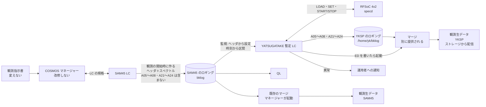

# SAM45 の肩代わりの検討

YATSUGATAKE で SAM45 の故障した Array（A05〜A08、A21〜A24）を肩代わりするための検討と、決めたこと。
既存のシステムの構成（観測指示書 → COSMOS マネージャー → LC → ロギング → QL・マージ）は
[`../cosmos/observation-flow.md`](../cosmos/observation-flow.md) にあり、ここではそれを前提にする。

## 優先度（2026-11-06 決定）

1. **スピード。** SAM45 はすでに故障しているので、できるだけ早く実装を終える。
2. **観測者の手順の変更を最小にする。** 多少の変更（変換スクリプトを手で実行する程度）は許容する。

## 決めたこと

| 項目 | 決定 | 理由 |
|---|---|---|
| マネージャー | **改修しない**（11-06） | 改修には COSMOS 全体の再コンパイルが要り、リスクがある |
| 設定とタイミングの受け取り | **SAM45 のロギングの監視だけで完結させる**（下の b5。11-06、MLPPS の b4 から変更） | ロギングは観測の開始時にでき、ヘッダに分光の設定が全部ある。最初のスペクトルまで ≒ 30 s あり、Overlay の載せ替えに間に合う。観測者の手順も COSMOS も変えずに済む |
| スペクトルの書き出し | **SAM45 のロギングの時刻に合わせて、SAM45 と同じ形式で書く**（下の c4。11-06） | SAM45 が実際に積分した時刻をそのまま使える。既存のマージがそのまま使える |
| 出力 | **YKSP のロギングを別に書き、観測が終わったらマージして、SAM45 とは別の観測生データ（YKSP）を作る**（下の「方針の見直し」。11-10、合体から変更） | SAM45 のロギングと観測生データに手を入れずに済む。SAM45 LC の改修も見張りも要らない |
| 肩代わりする Array | **A05〜A08・A21〜A24**（11-10）。将来、ほかの Array を足すかもしれない | |
| 肩代わりの Array の設定 | **A05〜A08 は A01〜A04、A21〜A24 は A17〜A20 と同じ周波数の設定で観測することを制約とする**（本番も。11-10） | SAM45 のロギングに A05〜A08・A21〜A24 が含まれないので、設定を A01〜A04・A17〜A20 から写す。A01〜A04 を使わない観測では、対応する A05〜A08 は作れない |
| 進め方 | **段階 1 → 1.5 → 2**（下の「段階の進め方」。11-06、11-10 に 1.1 をやめた） | 別々のロギング・同じ IF での比較から始め、合体と IFATT の無効化を 1 つずつ確かめてから本番にする |
| ~~段階 2 の合体~~ | ~~SAM45 LC を `_` 付きのファイル名で書かせ、暫定 LC が合体して正規の名前で書く~~（11-06 → 11-10 にやめた。下の「段階 2 の合体（やめた）」） | 別の観測生データにする方針になった |
| 積分時間のずれ | **許容する**（11-06） | SAM45 は 40 ms・100 ms、YATSUGATAKE は 10.24 ms の倍数（40.96 ms・102.4 ms）。このずれは科学観測上は問題にならない |
| 積分の当て方 | **YATSUGATAKE は 10.24 ms で記録し、SAM45 の各積分の区間に重なるダンプを束ねて差し込む**（下の t2。11-06） | 区切りのずれが端で ≒ 5 ms に収まる。10.24 ms の記録は差し込み後に削除する |
| 周波数軸 | **差し替える Array の L1 の周波数の欄を YATSUGATAKE の値に書き換える**（下の f2。11-06） | 補間せずに YATSUGATAKE のデータをそのまま正確に使える |
| Wide と Fine の同時 | **できない制約として受け入れる**（11-06） | 肩代わりする Array に 500 MHz 以上と 250 MHz 以下が混ざる観測には対応しない。実際は 250 MHz 以下の組み合わせが多く、実用上は影響しない見通し |
| IFATT | **肩代わりの運用中は、指示書の `iary_ifatt` に何が入っていても 0 として扱う**（下の「値と IFATT」。11-06） | YATSUGATAKE はダイナミックレンジが広く、R でレベルを下げる必要がない |
| 状態の知らせ方 | **暫定 LC のログ＋運用者への通知**（下の「状態の知らせ方」。11-06） | MLPPS をやめたので、COSMOS に状態を返す経路が無い |

## 全体の構成

## 方針の見直し（2026-11-10 決定）

| 項目 | 決めたこと |
|---|---|
| 入力 | SAM45 のロギングを読む。周波数の設定・積分の開始の時刻など、要る情報は全部 SAM45 のロギングから受け取る（b5 のまま） |
| SAM45 のロギングの A05〜A08・A21〜A24 | **含まれない**（2026-11-10 に変更。先に聞いた「ダミー（0）で書かれる」から変わった）。YKSP は **A01〜A04・A17〜A20 の設定（L1）を写して** A05〜A08・A21〜A24 を作り、L2 の付随の欄（時刻・スキャンの種類など）も A01〜A04・A17〜A20 の L2 から写す（設定の `mirror`）。SAM45 のロギングに含まれているときは、その設定を使う |
| YKSP のロギング | **`/home/yk/bklog`（一時置き場のディスク）の下に書く。** 書き終えたら、別にマウントするストレージ（RAIDZ）に移す（[`data-delivery.md`](data-delivery.md)）。 Array は **A05〜A08・A21〜A24** |
| 書く Array | 将来、足すかもしれない。Array の割り当て（設定の `assign`）で増やせる形を保つ |
| マージ | YKSP のロギングを書き終えたら（観測の終わり）、**暫定 LC がマージを起動**して観測生データ（YKSP）を作る。マージのソフトは別に提供される（2026-11-10 時点で未着。使い方も後で知らされる） |
| 観測生データ（YKSP）の置き場所 | ストレージ・制御サーバーのストレージ。所内 LAN に LDAP の認証で配る。保管はまず 1 年（[`data-delivery.md`](data-delivery.md)） |

これまでとの違い:

- 観測者は SAM45 の観測生データと、**別に観測生データ（YKSP）**を受け取る。「1 つの観測生データの中で、SAM45 が故障していないように見せる」ことはしない
- **合体（段階 1.1・2）をやめた。** SAM45 LC の `_` 付きの名前への改修・観測中の合体・見張り（`combine.py`・`watchdog.py`・`lc.py` の `output: combined`）は使わない。コードは残すが、運用には入れない

## 設定とタイミングの受け取り（b5. ロギングの監視）

暫定 LC が SAM45 のロギングの置き場所を監視し、新しいファイルができたら、そのヘッダから肩代わりする Array（A05〜A08・A21〜A24）の分光の設定を読む。観測者の指示書にも COSMOS にも手を入れない。

形式は [`../cosmos/sam45-logging.md`](../cosmos/sam45-logging.md)。

1. **ファイルの生成を見つける**: ロギングはネットワークマウントの上なので、inotify は効かない見込み。**1 s 程度の間隔で見回る**
2. **ヘッダを読む**: L0・L1 はファイルができたとき（観測の開始 `cst_time` の頃。ログ ID の時刻はそれより前。2026-11-10 に bklog で確認）に書かれる。ファイルの大きさが L0 ＋ L1（88 ＋ 8472 B）に達したら、L1 の `iary_usefg`・`dbebw`・`dfqdat_*`・`csid_type` などを読む
3. **設定を YATSUGATAKE に移す**: 必要な bit が今と違えば `LOAD`、続けて `SET`、`START`。bit が同じなら `LOAD` は省く
4. **記録**: tint 10.24 ms で、観測の終わりまで連続で記録する（区切りは t2 で SAM45 の時刻に合わせるので、開始の精度は要らない）
5. **終わりの判定**: ロギングの最後の **`ED` レコード**で判定する

### 起動したときに既にあるロギングは扱わない（2026-11-10 決定）

暫定 LC は、起動した時点（マウントが後なら、置き場所を初めて読めた時点）に置き場所にあるファイルを一覧で覚え、
それ以外の新しいファイルだけを扱う（設定の `skip_existing`）。

ファイル名のログ ID（時刻）を起動の時刻と比べる案は採らなかった。理由:

1. **ログ ID は観測の開始より前に付く。** bklog で見た観測では、ログ ID はファイルができる 1 分 42 秒前・20 秒前だった
   （[`../cosmos/sam45-logging.md`](../cosmos/sam45-logging.md) の「bklog で見た時刻」）。ログ ID とファイルの生成の間に
   起動すると、起動の後に始まった観測を「起動より前」と判定して取りこぼす。一覧で判定すれば正しく扱える
2. **時計に頼らない。** ログ ID は COSMOS の計算機の時計（JST）で付き、比べる相手は暫定 LC の計算機の時計になる。
   時計のずれや JST と UTC の取り違えで判定を誤りうる
3. **ファイル名の形に頼らない。** 名前の形は前提と違っていた（`<ログ ID>.SAM45....` を前提にしていたが、bklog では
   `SAM45....<ログ ID>`）。名前の中の時刻を判定に使わなければ、形が変わっても影響を受けない

どちらの案でも、**観測の途中で起こし直すと、その観測は扱わない**。途中から拾っても、最初の R などの前半のスペクトルが無いので、
これは意図した動き。本番で途中から取り直す要があれば、「ED がまだ無いファイルを拾う」形を検討する。

### 準備の時間の予算

**締め切りは最初の R の積分の開始。** ロギングができてから（観測の開始 `cst_time` の頃。ログ ID の時刻ではない）、最初の R までに次を終える。
その前の ZERO は固定の値でよいので、分光計がセットアップの途中でも構わない（2026-11-06）。
最短で ≒ 30 s と見込む（サンプルではログ ID から最初の R まで ≒ 8 分あった。ログ ID は観測の開始より前に付くので、
`cst_time` から最初の R までは、これより短い。bklog の観測で測る）。

| 手順 | 見込み |
|---|---|
| ファイルの生成に気づく | ≦ 見回りの間隔（≒ 1 s） |
| ヘッダを読む | 数 s 以下 |
| `LOAD`（bit が変わるときだけ） | 10〜20 s（YATSUGATAKE の specd の LOAD） |
| `SET`・`START`（START は tint の倍数の時刻に置かれる） | 1 s 以下 |

- **30 s のばらつき**（観測のモードで短くならないか）を確かめる。余裕が足りないときは、最初の数積分を差し込めないことを受け入れるか、bit の載せ替えを避ける運用（同じ bit が続く観測をまとめる）を考える
- 実際の時間は段階 1 の試験で測る

### 状態の知らせ方

MLPPS をやめたので、YATSUGATAKE の異常を COSMOS に返す経路は無い。

- 暫定 LC は、異常の時刻と中身を**自分のログ**に残す（どの観測・どの区間が怪しいかを後から追えるように）
- 段階 1: **運用者への通知**（メール・Slack など。手段は決める）と、今の状態を見るコマンドを用意する
- YKSP のロギングの L2 に異常の印を付ける。L2 の **`idmy_flag`（0 有効・1 無効）** を使う（マージがこの印をどう扱うかは、マージのソフトが届いてから確かめる）

### ほかの案（採らなかった）

| 案 | 中身 | 採らなかった理由 |
|---|---|---|
| b4. MLPPS（11-06 にいったん採用） | 指示書の MLPPS で python を実行し、暫定 LC に設定・ステータスを送る。MLPPS 行は変換スクリプトで挿入 | ロギングのヘッダに設定が全部あるとわかり、要らなくなった。観測者の手順（指示書の変換）が増え、設定を指示書から写す手間と食い違いの心配もあった |
| b1. 中継（proxy） | マネージャーと SAM45 LC の間に中継を置き、命令の写しを YATSUGATAKE 側に渡す | 作る量が多い |
| b2. SAM45 LC から渡す | SAM45 LC を改修し、受けた命令を YATSUGATAKE 側にも渡す | SAM45 LC の改修が要る |
| b3. 装置として足す | YATSUGATAKE 用の LC を装置としてマネージャーに足す | マネージャーの改修（COSMOS 全体の再コンパイル）が要る |

## スペクトルの書き出し（c4）

暫定 LC は SAM45 のロギングを追いかけ、SAM45 と**同じ形式**で、肩代わりする Array の分を書く。

- YATSUGATAKE は 10.24 ms ごとのスペクトルを、自分の時刻（1PPS・10 MHz に同期）を付けて一時ファイルに記録しておく（下の「時刻と積分」）
- 一時ファイルは、ロギングを書き終えたら削除する

### YKSP のロギング

SAM45 のロギングと**並行して、別のファイル**に書く（どの段階でも。2026-11-10）。

| | 中身 |
|---|---|
| ファイル名 | SAM45 のロギングの名前の `SAM45` を **`YKSP`** にしたもの（bklog の形なら `YKSP.<指示書名>.<group>.<project>.<ログ ID>`）。置き場所は **`/home/yk/bklog` の下**（PSW と OTF で分ける。今の設定は `yksppsw/`・`ykspotf/`）（2026-11-10） |
| L0 | SAM45 のものを写す。中の名前（`clog_name`）とバックエンドの種類（`cbe_type`）は今は `SAM45` のまま。【未定: 別に提供されるマージが求める値に合わせる】 |
| L1 | SAM45 のものを写し、肩代わりする Array（A05〜A08・A21〜A24）だけを使う設定に書き換える: `iary_usefg`（ほかの Array は 0）・`iary_num`・周波数の欄（f2）・`iary_ifatt`（IFATT のモードによる） |
| L2 | SAM45 が L2 を書くたびに、その積分の区間の 10.24 ms のダンプを束ね、肩代わりする Array の分を書く。時刻・スキャンの種類などの付随情報は、同じ積分の SAM45 の L2 から写す。ZERO は 8192 |
| ED | SAM45 が ED を書いたら書く |

肩代わりする Array だけの L1 でマージが通るかは、マージのソフトが届いてから確かめる。

### 観測生データ（YKSP）を作る（2026-11-10 決定）

- 暫定 LC は YKSP のロギングに ED を書いたら、別に提供されるマージを起動し、観測生データ（YKSP）を作る
- マージのソフトと使い方は後で知らされる。起動の仕方（引数・ほかの装置のロギングとの結び付け）・失敗したときの扱い・観測生データの置き場所は、そのときに決める【未定】
- 起動に失敗したり、マージが失敗したりしたら、自分のログに残して運用者に知らせる。YKSP のロギングは残すので、後から手でマージし直せる

### IFATT のモード

暫定 LC に切り替えを持たせる。

| モード | L1 の `iary_ifatt` | IFATT の制御プログラム | YKSP の R | 使う段階 |
|---|---|---|---|---|
| **従う** | 指示書の値のまま | 改修しない（IF 入力 5〜8 も R で ATT を足す） | SAM45 と同じだけ減衰 | 1 |
| **無視する** | 0 に書き換える | 改修して、IF 入力 5〜8 では R の ATT を足さない | 減衰しない | 1.5・2 |

### 段階の進め方

| 段階 | IF | IFATT | 確かめること |
|---|---|---|---|
| **1** | **A01〜A04 と同じ IF を A05〜A08 に入れる** | 従う | YKSP のロギングでマージが通るか。同じ信号で SAM45（A01〜A04）と YKSP（A05〜A08）の**生の値**（ZERO・R・SKY・ON・OFF）と周波数軸・時刻が合うか |
| **1.5** | 同じ IF | **無視する** | SAM45 はマージが `iary_ifatt` で補正し、YKSP は ATT 0 で補正しない。**較正後の値**（Tsys・強度）が SAM45 と合うか |
| **2**（本番） | 本番の IF | 無視する | 観測者が観測生データ（YKSP）を受け取れるか。観測者の手順が変わっていないか |

- どの段階も、YKSP のロギングを `/home/yk/bklog` の下に書き、観測が終わったら暫定 LC がマージを起動して観測生データ（YKSP）を作る（2026-11-10）。段階で変わるのは IF と IFATT のモード
- マージのソフトが届くまでは、段階 1 の比較は YKSP のロギングと SAM45 のロギングを直接比べる（`compare.py`）
- 段階 1 の比較は、SAM45 の IF 系で別の Array に同じ IF を入れられることを使う（運用の経験あり。2026-11-06）
- 比べるときに出ると見込む違い: ch 間隔（2.4 %、f2 で L1 に正しく書けているか）・バンドパスの形・量子化（3 bit と 14 bit）

### 段階 2 の合体（2026-11-06 に決め、2026-11-10 にやめた）

11-06 には、本番（段階 2）で SAM45 と YKSP を 1 つのロギングに合体し、既存のマージで 1 つの観測生データにする予定だった:

- SAM45 LC を改修して、ロギングを `_` を頭に付けた名前で書かせる。暫定 LC が `_` のファイルを追いかけ、YKSP の分を合体して正規の名前で積分ごとに書く（`lc.py` の `output: combined`、`combine.py`）
- 暫定 LC が落ちたら、別の見張り（`watchdog.py`）が `_` のファイルを正規の名前に写す。心拍と受け持ちの印で切り替える
- 段階 1.1 で、段階 1 のデータを観測後に合体して確かめる

**やめた理由**（2026-11-10）: 観測生データ（YKSP）を別に作る方針に決まった（上の「方針の見直し」）。合体では、暫定 LC が止まると SAM45 のほかの Array まで失うおそれがあり、SAM45 LC の改修と見張りも要った。別の観測生データにすれば、SAM45 のロギングと観測生データには手を入れずに済む。
代わりに、観測者は観測生データを 2 つ（SAM45 と YKSP）受け取る。また QL に A05〜A08・A21〜A24 は出ない（SAM45 のロギングに含まれない。2026-11-10）。

コード（`combine.py`・`watchdog.py`・`lc.py` の `output: combined`・心拍）は残すが、運用には入れない。

### ほかの案（採らなかった）

| 案 | 中身 | 採らなかった理由 |
|---|---|---|
| 開始・終了を MLPPS で送り、YATSUGATAKE が自分で書く | 積分の区切りを MLPPS で伝える | MLPPS の実行時間と逐次の実行で、SAM45 との時刻のずれが入る。OTF ではスキャンごとに行が増える |
| c2. SAM45 LC が受け取って書く | YATSUGATAKE のスペクトルを SAM45 LC に渡す | SAM45 LC の改修が大きい |
| 段階 1 でマージ後の観測生データに差し込む（11-06 にいったん採用） | マージの後に運用側が観測生データに書き込む | 観測生データの形式を知る必要があり、差し込みの処理がロギング用と 2 つになる。YKSP のロギングを別に書いて既存のマージにかけるほうが、段階 2 と同じ処理で済む |
| c3. マージで差し替える | マージ・QL が差し替える | マージ・QL の改修が要る。マージは観測者からアクセスできない |

## 時刻と積分

### YATSUGATAKE の積分の段

| 段 | 積分の単位 | 出典（YATSUGATAKE リポジトリ） |
|---|---|---|
| PL | **BASE = 10.24 ms**（格子 2.048 ms の 5 倍）ごとにダンプする | `docs/design/sam45-fine/README.md`・`docs/design/sam45-wide/README.md` |
| PS（specd） | PL のダンプを n_sum 個束ねて **tint = BASE の倍数**にする。既定は 40.96 ms（4 × BASE） | `docs/spec/timing.md`・`docs/spec/interface.md` の 5. |

- specd は取得の開始を **T（ボードの時刻）の tint の倍数**に置く。区切りは 1PPS・10 MHz に同期した YATSUGATAKE の時刻の格子に乗り、SAM45 の区切りとは揃わない
- 短い tint の実績（YATSUGATAKE v1.0.0 の性能評価）:
  - SAM45-Fine: **10.24 ms で 30 分、取りこぼし 0**。ただし取得の CPU ≒ 75 % で loop_slow が出る（40.96 ms では 0）
  - SAM45-Wide: **40.96 ms でしか判定していない**
  - ネットワーク: 8 窓 × 4096 ch × float32 で、10.24 ms でも 12.8 MB/s（1 ボードの予算 30 MB/s に入る）

### SAM45 の積分時間との対応

**PSW**: 積分時間は秒の単位（サンプルでは ZERO 1 s、ほか 5 s）で、**1PPS の秒の境界から始まる**（2026-11-06）。
ロギングの時刻（`cint_sttm`・`cint_edtm`・`dint_stmjd`・`dint_edmjd`）は 1 s の分解能だが、秒の境界に乗っているので、そのまま積分の区間として使える。
1 s は 10.24 ms の倍数でないので、区間の両端で 10.24 ms のダンプが半端になる。端のずれは最大 ≒ 5 ms で、5 s の積分に対して 0.1 % 程度。

**OTF など短い積分**: 積分時間 **40 ms・100 ms**。YATSUGATAKE の tint は 10.24 ms の倍数なので、近い値は次のとおり。OTF のロギングの時刻は積分の中心で、ms まで入る。

| SAM45 | YATSUGATAKE の tint | 差 |
|---|---|---|
| 40 ms | 40.96 ms（4 × BASE） | +2.4 % |
| 100 ms | 102.4 ms（10 × BASE） | +2.4 % |

この長さの差は、科学観測上は問題にならないので**許容する**（2026-11-06）。

### SAM45 の 1 積分に YATSUGATAKE のどのスペクトルを当てるか（2026-11-06 決定: t2）

| 案 | YATSUGATAKE の tint | 当て方 | 区切りのずれ | 懸念 |
|---|---|---|---|---|
| t1. SAM45 と同じ長さ | 40.96 ms / 102.4 ms（ヘッダの積分時間に合わせて切り替える） | SAM45 の積分の中心に最も近い 1 つ | 最大で tint の半分（≒ 20 ms / 51 ms） | 区切りの位相が SAM45 と揃わない。OTF では位置のずれになる |
| t2. 短く記録して束ねる | 10.24 ms（または 20.48 ms）で記録 | SAM45 の積分の区間に重なるダンプを差し込みのときに束ねる | 端で最大 BASE の半分（≒ 5 ms）程度 | SAM45-Wide を短い tint で運転した実績がない。データ量が 4 倍（10.24 ms で ≒ 46 GB/時） |

**t2 を採る**（2026-11-06）。
- SAM45 の区間に最も近づけられ、SAM45 の積分時間（40 / 100 ms）に合わせて tint を切り替える必要もない
- YATSUGATAKE は **tint 10.24 ms** で記録する（20.48 ms は、下の試験で 10.24 ms に問題が出たときの代わり）
- 10.24 ms の記録は**一時ファイル**として扱い、YKSP のロギングを書き終えたら削除する。ディスクへの影響は残らない
- **要る試験**: SAM45-Wide を tint 10.24 ms で長時間運転し、取りこぼしがないことを確かめる（SAM45-Fine は 30 分の実績あり。どちらも観測の長さを想定した時間で確かめる）

## SAM45 らしく見せるために合わせるもの

観測生データの中で SAM45 の Array として違和感なく扱われるには、少なくとも次を合わせる必要がある。

- **ch 数・周波数軸**: 下の「周波数軸」
- **時刻と積分**: 上の「時刻と積分」
- **値の大きさ**: 下の「値と IFATT」
- **Tsys**: 下の「Tsys」
- **付随する情報**: L2 のほかの欄（`cary_name`・`cscan_type`・時刻・`dweather` など）は、同じ積分の SAM45 のほかの Array の L2 から写す

### 周波数軸

SAM45 と YATSUGATAKE は、どちらも 4 GSPS で第 2 ナイキストの 2〜4 GHz を入れる。**同じ 2〜4 GHz の IF を分ければ、周波数の変換は要らない**（ただし YATSUGATAKE の fs は 4096 MSPS）。

| SAM45 の帯域（`dbebw`） | YATSUGATAKE の bit と帯域 | ch 間隔（SAM45 / YATSUGATAKE、4096 ch） |
|---|---|---|
| 2000 MHz | SAM45-Wide 2048 MHz（**窓 1 つ**） | 488.3 / 500 kHz |
| 1000 MHz | SAM45-Wide 1024 MHz | 244.1 / 250 kHz |
| 500 MHz | SAM45-Wide 512 MHz | 122.1 / 125 kHz |
| 250 MHz | SAM45-Fine 256 MHz | 61.04 / 62.5 kHz |
| 125 MHz | SAM45-Fine 128 MHz | 30.52 / 31.25 kHz |
| 62.5 MHz | SAM45-Fine 64 MHz | 15.26 / 15.625 kHz |
| 31.25 MHz | SAM45-Fine 32 MHz | 7.629 / 7.8125 kHz |
| 15.625 MHz | SAM45-Fine 16 MHz | 3.815 / 3.906 kHz |

- どの帯域も YATSUGATAKE のほうが 2.4 % 広い（2000 / 2048）。**ch 間隔が SAM45 と一致しない。**
- **f2 を採る**（2026-11-06）: 差し替える Array の **L1 の周波数の欄を YATSUGATAKE の値に書き換える**。スペクトルは補間しない
  - 書き換える欄（`mapping.rewrite_l1`）: `dbebw`・`dbechwid`・`dberes`・`dfqdat_fq`（`dfqdat_ch` の 2 点の ch の sky を、丸めずに書く）。`dcent_freq`・`dtrk_freq`・`dfqdat_f0` は観測の指定なので変えない。マージ・QL がどの欄を使うか、`dbebw` に SAM45 に無い値（32e6 など）を入れてよいかを確かめる
  - sky の軸の作り方（`mapping.sam45_window`）: SAM45 の窓の中心（ch 2048.5）の sky を `dfqdat_f0` とし、傾きは ±1（向きは `dfqdat` の 2 点から）。`dfqdat_fq` は 10 kHz に丸めてあるので、傾きには使わない
  - **サブアレイ**: YATSUGATAKE は窓ごとに帯域を変えられるのでサブアレイの考えは要らないが、**sam45compat では SAM45 を踏襲し、サブアレイごとの帯域の設定とする**（2026-11-06）。L1 の窓の欄（`istart_chan` など）は [サブアレイ][窓] で、肩代わりする A05〜A08・A21〜A24 はどれもサブアレイ 0（`mapping._sub_of`）
  - SAM45 の 524,288 ch と IF の対応は **IF = 2000 MHz ＋ k·(2000 MHz / 524288)（k が増えると IF が上がる）と仮定**（`mapping.Sam45IfModel`）。向きと ch の中心の位置（半 ch のずれ）は未確認で、段階 1 の同じ IF の比較で確かめる。窓が中央（3 GHz）にあるサンプルでは区別できない
  - 窓の中心は SAM45 の指定（`dfqdat_f0` など）に合わせ、YATSUGATAKE の窓を置く。YATSUGATAKE の窓の中心は格子（Fine は NCO の分解能、Wide は 125 kHz の ch）に寄るので、寄せた後の実際の値で L1 を書く
  - 採らなかった案 f1: YATSUGATAKE のスペクトルを SAM45 の ch の格子に補間し直す（L1 はそのままだが、分解能と雑音の ch 間の相関が変わる）
- **Wide と Fine は同時に使えない**（別の bit）。1 つの観測で肩代わりする Array に 500 MHz 以上と 250 MHz 以下が混ざるときは、肩代わりできない制約として受け入れる（2026-11-06）。そのときは **250 MHz 以下の Array を取り**、取れない Array は **`idmy_flag` = 1 で差し込み、運用者に知らせる**（2026-11-06）
- SAM45 は ch が増えると周波数が下がる向き（サンプルの USB）。YATSUGATAKE の ch の向きとの対応を合わせる。
  2026-11-12 の観測（87 GHz 帯）は逆に ch が増えると上がる向きだった。向きは観測ごとに `dfqdat` の 2 点から決める（`mapping.sam45_window`）
- **SAM45 の ch 数が 4096 より少ないとき**（2026-11-12）: SAM45 は 1 Array を 2048 ch で出すことがある（2026-11-12 の 2 窓の観測。
  62.5 MHz を 8 ch ずつ束ねて 2048 ch、30.52 kHz。`ichannel` = 2048）。今までは 4096 ch しか受けず、肩代わりの Array を全部取らなかった。
  YATSUGATAKE は同じ帯域の窓を 4096 ch で取り、**隣り合う 4096 / `ichannel` 個を平均して同じ ch 数にする**（`YkWindow.nbin`。受けるのは 4096・2048・1024）。
  ch 間隔は YATSUGATAKE の値（64 MHz / 2048 = 31.25 kHz）で、f2 と同じく L1 の `dbechwid`・`dberes`・`dfqdat_fq` を書き換える。
  L2 の `fary_data`（4096 個）は、SAM45 と同じく前から `ichannel` 個に値を入れ、残りを 0 にする（SAM45 の L2 で、前の 2048 個だけが 0 でないことを確かめた。2026-11-12）。
  YATSUGATAKE の記録は窓ごとに 4096 ch（`recorder` が受けるのも 4096 ch）なので、平均は LC の側で行う。比べる道具（`compare.py`）は 4096 ch のままで、2048 ch の観測には使えない

### 値と IFATT

- SAM45 の ADC は 3 bit でダイナミックレンジが狭いので、R のときに IFATT（`iary_ifatt` dB）を足してレベルを下げている
- YATSUGATAKE はダイナミックレンジが広いので、R でレベルを下げる必要はない。R の値は SKY より大きくなる
- **肩代わりの運用中は、指示書の `iary_ifatt` に何が入っていても、YATSUGATAKE 暫定 LC は 0 として扱う**（2026-11-06）。観測者の手順は変えない
- **物理の IFATT は YATSUGATAKE の経路にも入る**（2026-11-06）:
  - SKY でのレベル合わせは今までどおり行う（SKY・R に同じだけ効くので、較正には影響しない）
  - **IFATT の制御プログラムを改修し、IF 入力 5〜8（A05〜A08・A21〜A24）では R のときの ATT の追加を無視する**（2026-11-06 の予定）。これで YATSUGATAKE の R は減衰しないので、数値で戻す処理は要らない
  - ただし段階 1 は IFATT に**従う**モードで、改修は段階 1.5 から入れる（上の「IFATT のモード」）
- **L1 の `iary_ifatt` も 0 に書き換える**（2026-11-06）: QL・マージは `iary_ifatt` を Tsys と強度の計算に使う。L1 が指示書の値（例 5 dB）のままだと、減衰していない YATSUGATAKE の R に補正がかかってしまう。f2 で L1 を書き換えるのと同じ処理で、差し替える Array の `iary_ifatt` を 0 にする
- SKY のレベル合わせは SAM45（3 bit）に合わせた値になる。そのときの RFSoC の入力のレベルが、YATSUGATAKE に適した範囲（R でも飽和しない、量子化の雑音が効かない）に入るかを確かめる
- 値の絶対的なスケール（SAM45 の数え方に合わせるか）は、強度の較正（R・SKY）で相殺される。合わせる必要があるのは QL の表示の都合くらい
- ZERO は固定の値でよい（2026-11-06）。SAM45 と同じ 8192 を入れる

### Tsys

- `dtsys` は SAM45 LC が R・SKY から計算して L2 に書き、QL・マージが参考値として表示する（2026-11-06）
- 肩代わりする Array では、YATSUGATAKE の R・SKY から計算して書く（`yksp.tsys_k`、2026-11-06）
- サンプルから逆算した SAM45 の式: **Tsys = T_R·(SKY − ZERO) / ((R − ZERO)·10^(IFATT/10) − (SKY − ZERO))**（ch の平均）。T_R は 4 Array とも ≒ 293.0 K（±0.2）で、`T_R` = 293 K で SAM45 の値を 0.1 % 以内で再現する。T_R が固定の値か、測った温度かは未確認（担当者に確認中。L2 の `dweather[0]`（気温、サンプルでは 14.3 °C = 287.45 K）とは違い、それを使うと Tsys が ≒ 2 % 低くなる）
- SAM45 と同じく、R を覚えて SKY で計算し、以後のスキャンにその値を書く（最初の SKY までは 0）。YATSUGATAKE の値は ZERO が 0 なので引かない（ZERO の 8192 は SAM45 に合わせて書くだけ）

## ハードウェアの前提

- 故障した Array に入っていた IF 入力 5〜8 を、RFSoC の ADC_A〜D に入れ直す（分岐するか、つなぎ替えるか）
- SAM45 の入力も 2〜4 GHz（第 2 ナイキスト）なので、**周波数の変換は要らない**（2026-11-06）
- 10 MHz・1PPS を SAM45 と同じ基準からとる

## 未確認のこと

答えがわかったら、既存のシステムについての事実は [`../cosmos/`](../cosmos/) に、
そこから決めたことはこのファイルの上の節に書く。

### ロギング
- [ ] 観測の途中で分光の設定が変わることはあるか（L1 だけで 1 観測の設定が決まるか）
- [ ] ログ ID から最初の R までの時間の最短（観測のモードで短くならないか）
- [ ] SAM45 LC が L2 を書き足すタイミング（積分の終わりからどのくらいで書くか）
- [ ] **マージのソフトと使い方**（別に提供される。2026-11-10 時点で未着）: 起動の仕方、ほかの装置のロギングとの結び付け、L0 の名前・バックエンドの種類に何を求めるか
- [ ] 肩代わりする Array だけの L1（`iary_usefg`・`iary_num` を書き換えたもの）でマージが通るか
- [ ] マージが `idmy_flag` と `dbebw` の SAM45 に無い値（32e6 など）をどう扱うか

### SAM45 の仕様
- [ ] f2 で書き換える L1 の欄（マージ・QL が周波数軸の計算に使う欄はどれか）
- [ ] `istart_chan`・`iend_chan`（524,288 ch の番号）と IF 周波数の対応: 向き（k が増えると IF が上がるか）と、ch の中心の位置。今は IF = 2000 ＋ k·Δ と仮定
- [ ] マージ・QL が `dbebw` に SAM45 に無い値（32e6 など）を受け付けるか
- [ ] SKY でレベルを合わせた IFATT のときの RFSoC の入力のレベル（YATSUGATAKE に適した範囲か）
- [ ] Tsys の T_R（≒ 293 K）は固定の値か、測った温度か（式はサンプルから逆算した）
- [ ] OTF のロギング（時刻・`diptim`・40 / 100 ms の対応）。サンプルが要る

### ハードウェアと運用
- [ ] IF の分け方（IF 入力 5〜8 を SAM45 の前で分岐するか、つなぎ替えるか）
- [ ] RFSoC と暫定 LC の置き場所と、COSMOS のネットワークへのつなぎ方
- [ ] 運用者への通知の手段

### 解決したこと
- [x] 観測生データ（YKSP）の置き場所 → ストレージ・制御サーバー。配信は [`data-delivery.md`](data-delivery.md)（2026-11-10）
- [x] 出力の形 → YKSP のロギングを別に書き、暫定 LC がマージを起動して別の観測生データ（YKSP）を作る。合体（段階 1.1・2）はやめた（2026-11-10）
- [x] YKSP のロギングの置き場所 → `/home/yk/bklog` の下。暫定 LC の計算機（yk-c）から SAM45 のロギング（bklog）を NFS で読める（2026-11-10）
- [x] 故障した Array の今の状態 → SAM45 のロギングには A05〜A08・A21〜A24 が含まれない。YKSP は A01〜A04・A17〜A20 から作る（2026-11-10 に変更。先には「ダミー（0）で書かれる」だった）
- [x] 肩代わりする Array → A05〜A08・A21〜A24。将来ほかの Array を足すかもしれない（2026-11-10）
- [x] SAM45 の積分時間 → 40 ms・100 ms（OTF など）。PSW は秒の単位で、1PPS の秒の境界から始まる（2026-11-06）
- [x] マネージャーを改修できるか → 再コンパイルが要りリスクがあるので避ける（2026-11-06）
- [x] 分光の設定をどこから得るか → ロギングの L1 に全部ある。ロギングはログ ID の時刻にでき、L0・L1 がそのとき書かれる（2026-11-06）
- [x] 準備の締め切り → 最初の R の積分の開始。ZERO は固定の値でよい（2026-11-06）
- [x] MLPPS の動き → MLPPS を使わないことにしたので調べない（2026-11-06）
- [x] 観測生データの形式 → 知らなくてよい。YKSP のロギングを SAM45 の形式で書き、既存のマージにかける（2026-11-06）
- [x] サブアレイ → A01〜A08 と A09〜A16 ごとに帯域を変えられ、運用で使われている。sam45compat は SAM45 を踏襲する（2026-11-06）
- [x] SAM45 LC の `_` 付きのファイル名への改修 → 別の担当者が行える（2026-11-06）。合体をやめたので要らない（2026-11-10）
- [x] 暫定 LC が止まったときの備え → YATSUGATAKE の異常では素通し、暫定 LC が落ちたら別の見張りが素通しで写す（2026-11-06）。合体をやめたので要らない（2026-11-10）
- [x] 同じ IF での比較の観測 → SAM45 の IF 系で別の Array に同じ IF を入れられ、指示書も通常どおり書ける（2026-11-06）
- [x] ロギングの形式・ファイルの単位 → 1 観測 1 ファイル、L0・L1・L2 × n・ED（[`../cosmos/sam45-logging.md`](../cosmos/sam45-logging.md)。2026-11-06）
- [x] 観測の終わりの判定 → `ED` レコード（2026-11-06）
- [x] 異常の印の欄 → L2 の `idmy_flag`（2026-11-06）
- [x] スペクトルの値 → float32 × 4096。ZERO は 8192 で一定、R は IFATT の分だけ下がっている（2026-11-06）
- [x] IF の周波数帯 → SAM45 も 2〜4 GHz（第 2 ナイキスト）を入れるので、変換は要らない（2026-11-06）
- [x] SAM45 の積分の時刻 → PSW は秒の境界、ロギングの時刻は 1 s の分解能（OTF は中心の時刻で ms まで）（2026-11-06）
- [x] 比べる基準 → サンプルの A05・A06 は故障前のデータ（2026-11-06）
- [x] 周波数軸の合わせ方 → f2（L1 の周波数の欄を書き換える）（2026-11-06）
- [x] Wide と Fine が混ざる観測 → 対応しない制約として受け入れる。実用上は 250 MHz 以下が多い（2026-11-06）
- [x] `iary_ifatt` → 指示書の値によらず 0 として扱い、L1 も 0 に書き換える（2026-11-06）
- [x] 物理の IFATT → YATSUGATAKE の経路にも入る。SKY のレベル合わせは行い、IFATT の制御プログラムを改修して IF 入力 5〜8 では R の ATT を足さない（2026-11-06）
