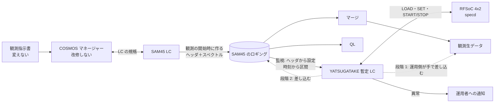

# SAM45 の肩代わりの検討

YATSUGATAKE で SAM45 の故障した Array（A05〜A08、A21〜A24）を肩代わりするための検討と、決めたこと。
既存のシステムの構成（観測指示書 → COSMOS マネージャー → LC → ロギング → QL・マージ）は
[`../cosmos/observation-flow.md`](../cosmos/observation-flow.md) にあり、ここではそれを前提にする。

## 優先度（2026-11-06 決定）

1. **スピード。** SAM45 はすでに故障しているので、できるだけ早く実装を終える。
2. **観測者の手順の変更を最小にする。** 多少の変更（変換スクリプトを手で実行する程度）は許容する。

## 決めたこと

| 項目 | 決定 | 理由 |
|---|---|---|
| マネージャー | **改修しない**（11-06） | 改修には COSMOS 全体の再コンパイルが要り、リスクがある |
| 設定とタイミングの受け取り | **SAM45 のロギングの監視だけで完結させる**（下の b5。11-06、MLPPS の b4 から変更） | ロギングは観測の開始時にでき、ヘッダに分光の設定が全部ある。最初のスペクトルまで ≒ 30 s あり、Overlay の載せ替えに間に合う。観測者の手順も COSMOS も変えずに済む |
| スペクトルの差し込み | **SAM45 のロギングの時刻に合わせて差し込む**（下の c4。11-06） | SAM45 が実際に積分した時刻をそのまま使える |
| 進め方 | **2 段階**。段階 1 は運用側の動作試験、すぐ続けて段階 2 で本番の形にする（11-06） | マージは観測者からアクセスできないので、マージ後の手作業は運用側で回す |
| 積分時間のずれ | **許容する**（11-06） | SAM45 は 40 ms・100 ms、YATSUGATAKE は 10.24 ms の倍数（40.96 ms・102.4 ms）。このずれは科学観測上は問題にならない |
| 積分の当て方 | **YATSUGATAKE は 10.24 ms で記録し、SAM45 の各積分の区間に重なるダンプを束ねて差し込む**（下の t2。11-06） | 区切りのずれが端で ≒ 5 ms に収まる。10.24 ms の記録は差し込み後に削除する |
| 状態の知らせ方 | **暫定 LC のログ＋運用者への通知**（下の「状態の知らせ方」。11-06） | MLPPS をやめたので、COSMOS に状態を返す経路が無い |

## 全体の構成

## 設定とタイミングの受け取り（b5. ロギングの監視）

暫定 LC が SAM45 のロギングの置き場所を監視し、新しいファイルができたら、そのヘッダから故障した Array（A05〜A08、A21〜A24）の分光の設定を読む。観測者の指示書にも COSMOS にも手を入れない。

1. **ファイルの生成を見つける**: ロギングはネットワークマウントの上なので、inotify は効かない見込み。**1 s 程度の間隔で見回る**
2. **ヘッダが書き終わるのを待つ**: 書きかけのヘッダを読まない判定（ヘッダの長さ・ファイルの大きさが落ち着く・終わりの印など。形式を見て決める）
3. **設定を YATSUGATAKE に移す**: 必要な bit が今と違えば `LOAD`、続けて `SET`、`START`。bit が同じなら `LOAD` は省く
4. **記録**: tint 10.24 ms で、観測の終わりまで連続で記録する（区切りは t2 で SAM45 の時刻に合わせるので、開始の精度は要らない）
5. **終わりの判定**: ファイルが閉じた・ファイルが伸びなくなった・次の観測のファイルができた、のどれで判定できるかは形式を見て決める

### 準備の時間の予算

ロギングができてから最初のスペクトルまで **≒ 30 s**（観測全体のセットアップ）。この間に次を終える。

| 手順 | 見込み |
|---|---|
| ファイルの生成に気づく | ≦ 見回りの間隔（≒ 1 s） |
| ヘッダを読む | 数 s 以下 |
| `LOAD`（bit が変わるときだけ） | 10〜20 s（YATSUGATAKE の specd の LOAD） |
| `SET`・`START`（START は tint の倍数の時刻に置かれる） | 1 s 以下 |

- **30 s のばらつき**（観測のモードで短くならないか）を確かめる。余裕が足りないときは、最初の数積分を差し込めないことを受け入れるか、bit の載せ替えを避ける運用（同じ bit が続く観測をまとめる）を考える
- 実際の時間は段階 1 の試験で測る

### 状態の知らせ方

MLPPS をやめたので、YATSUGATAKE の異常を COSMOS に返す経路は無い。

- 暫定 LC は、異常の時刻と中身を**自分のログ**に残す（どの観測・どの区間が怪しいかを後から追えるように）
- 段階 1: **運用者への通知**（メール・Slack など。手段は決める）と、今の状態を見るコマンドを用意する
- 段階 2: 差し込むデータに異常の印を付けられるか（SAM45 のロギングにフラグの欄があるか）を確かめる。印を付けられない区間は差し込まずに残すか、運用者に知らせる

### ほかの案（採らなかった）

| 案 | 中身 | 採らなかった理由 |
|---|---|---|
| b4. MLPPS（11-06 にいったん採用） | 指示書の MLPPS で python を実行し、暫定 LC に設定・ステータスを送る。MLPPS 行は変換スクリプトで挿入 | ロギングのヘッダに設定が全部あるとわかり、要らなくなった。観測者の手順（指示書の変換）が増え、設定を指示書から写す手間と食い違いの心配もあった |
| b1. 中継（proxy） | マネージャーと SAM45 LC の間に中継を置き、命令の写しを YATSUGATAKE 側に渡す | 作る量が多い |
| b2. SAM45 LC から渡す | SAM45 LC を改修し、受けた命令を YATSUGATAKE 側にも渡す | SAM45 LC の改修が要る |
| b3. 装置として足す | YATSUGATAKE 用の LC を装置としてマネージャーに足す | マネージャーの改修（COSMOS 全体の再コンパイル）が要る |

## スペクトルの差し込み（c4）

SAM45 のロギングにある各積分の時刻に対応する YATSUGATAKE のスペクトルを束ねて、故障した Array の分に差し込む。

- YATSUGATAKE は 10.24 ms ごとのスペクトルを、自分の時刻（1PPS・10 MHz に同期）を付けて一時ファイルに記録しておく（下の「時刻と積分」）
- 差し込みが終わったら、一時ファイルを削除する

### 2 段階の進め方

| | 段階 1: 運用側の動作試験 | 段階 2: 本番 |
|---|---|---|
| 設定とタイミング | ロギングの監視（b5） | 同じ |
| 差し込む先 | マージ後の観測生データ | マージ前の SAM45 のロギング |
| 実行 | **運用側**がマージの後に手で差し込みスクリプトを実行する | 暫定 LC が自動で差し込む |
| QL | 故障した Array は出ない | 出る |
| 観測者の手順 | 変えない（差し込みは運用側） | 変えない |
| 目的 | 設定の読み取り・準備の時間・周波数軸・時刻の対応・値のスケールを確かめる。段階 1 ではロギングを**読むだけ**なので、SAM45 の元データは安全 | 観測者から SAM45 が故障していないように見せる |

段階 1 と段階 2 は入口（ロギングの監視）が同じ。差し込みの処理（時刻の対応・周波数軸・スケールの変換）も段階 2 でそのまま使えるように作る。段階 2 で増えるのは、差し込む先と、マージとの競合の回避。

### 段階 2 で解決が要ること

- **マージとの競合**: 観測が終わるとマージがすぐに起動する。それまでに差し込みを終える（または、マージが待つ仕組みを既存の範囲で作れるか確かめる）
- **SAM45 LC との同時書き込み**: SAM45 LC が書いている途中のファイルに手を入れない。ファイルが閉じたことの判定方法
- **元データの保全**: 差し込む前の SAM45 のロギングを残す
- **ファイルの構造**: 故障した Array の区画がロギングにあれば上書き、なければ構造を変える必要がある
- **QL との関係**: 差し込むまでの間、QL には故障した Array の値が見える

### ほかの案（採らなかった）

| 案 | 中身 | 採らなかった理由 |
|---|---|---|
| 開始・終了を MLPPS で送り、YATSUGATAKE が自分で書く | 積分の区切りを MLPPS で伝える | MLPPS の実行時間と逐次の実行で、SAM45 との時刻のずれが入る。OTF ではスキャンごとに行が増える |
| c2. SAM45 LC が受け取って書く | YATSUGATAKE のスペクトルを SAM45 LC に渡す | SAM45 LC の改修が要る |
| c3. マージで差し替える | マージ・QL が差し替える | マージ・QL の改修が要る。マージは観測者からアクセスできない |

## 時刻と積分

### YATSUGATAKE の積分の段

| 段 | 積分の単位 | 出典（YATSUGATAKE リポジトリ） |
|---|---|---|
| PL | **BASE = 10.24 ms**（格子 2.048 ms の 5 倍）ごとにダンプする | `docs/design/sam45-fine/README.md`・`docs/design/sam45-wide/README.md` |
| PS（specd） | PL のダンプを n_sum 個束ねて **tint = BASE の倍数**にする。既定は 40.96 ms（4 × BASE） | `docs/spec/timing.md`・`docs/spec/interface.md` の 5. |

- specd は取得の開始を **T（ボードの時刻）の tint の倍数**に置く。区切りは 1PPS・10 MHz に同期した YATSUGATAKE の時刻の格子に乗り、SAM45 の区切りとは揃わない
- 短い tint の実績（YATSUGATAKE v1.0.0 の性能評価）:
  - SAM45-Fine: **10.24 ms で 30 分、取りこぼし 0**。ただし取得の CPU ≒ 75 % で loop_slow が出る（40.96 ms では 0）
  - SAM45-Wide: **40.96 ms でしか判定していない**
  - ネットワーク: 8 窓 × 4096 ch × float32 で、10.24 ms でも 12.8 MB/s（1 ボードの予算 30 MB/s に入る）

### SAM45 の積分時間との対応

SAM45 の積分時間は **40 ms・100 ms**。YATSUGATAKE の tint は 10.24 ms の倍数なので、近い値は次のとおり。

| SAM45 | YATSUGATAKE の tint | 差 |
|---|---|---|
| 40 ms | 40.96 ms（4 × BASE） | +2.4 % |
| 100 ms | 102.4 ms（10 × BASE） | +2.4 % |

この長さの差は、科学観測上は問題にならないので**許容する**（2026-11-06）。

### SAM45 の 1 積分に YATSUGATAKE のどのスペクトルを当てるか（2026-11-06 決定: t2）

| 案 | YATSUGATAKE の tint | 当て方 | 区切りのずれ | 懸念 |
|---|---|---|---|---|
| t1. SAM45 と同じ長さ | 40.96 ms / 102.4 ms（ヘッダの積分時間に合わせて切り替える） | SAM45 の積分の中心に最も近い 1 つ | 最大で tint の半分（≒ 20 ms / 51 ms） | 区切りの位相が SAM45 と揃わない。OTF では位置のずれになる |
| t2. 短く記録して束ねる | 10.24 ms（または 20.48 ms）で記録 | SAM45 の積分の区間に重なるダンプを差し込みのときに束ねる | 端で最大 BASE の半分（≒ 5 ms）程度 | SAM45-Wide を短い tint で運転した実績がない。データ量が 4 倍（10.24 ms で ≒ 46 GB/時） |

**t2 を採る**（2026-11-06）。
- SAM45 の区間に最も近づけられ、SAM45 の積分時間（40 / 100 ms）に合わせて tint を切り替える必要もない
- YATSUGATAKE は **tint 10.24 ms** で記録する（20.48 ms は、下の試験で 10.24 ms に問題が出たときの代わり）
- 10.24 ms の記録は**一時ファイル**として扱い、差し込み（段階 1 では観測生データ、段階 2 ではロギング）が終わったら削除する。ディスクへの影響は残らない
- **要る試験**: SAM45-Wide を tint 10.24 ms で長時間運転し、取りこぼしがないことを確かめる（SAM45-Fine は 30 分の実績あり。どちらも観測の長さを想定した時間で確かめる）

## SAM45 らしく見せるために合わせるもの

観測生データの中で SAM45 の Array として違和感なく扱われるには、少なくとも次を合わせる必要がある。

- **ch 数・周波数軸**: ch 数、ch の並び（向き）、分解能、帯域、中心の周波数（IF・LO の設定との対応）
- **時刻と積分**: 上の「時刻と積分」
- **値の大きさ**: スペクトルの単位・スケール。強度較正（チョッパーなど）で相殺される部分と、相殺されない部分（QL の表示、飽和・異常の判定の閾値など）を分ける
- **付随する情報**: Array ごとのヘッダ・状態・フラグなど、SAM45 がロギングに書いている項目

## ハードウェアの前提

- 故障した Array に入っていた IF 入力 5〜8 を、RFSoC の ADC_A〜D に入れ直す（分岐するか、つなぎ替えるか）
- IF の周波数帯が RFSoC の入力（2〜4 GHz を第 2 ナイキストで直接サンプリング）に合うか
- 10 MHz・1PPS を SAM45 と同じ基準からとる

## 未確認のこと

答えがわかったら、既存のシステムについての事実は [`../cosmos/observation-flow.md`](../cosmos/observation-flow.md) に、
そこから決めたことはこのファイルの上の節に書く。

### ロギング（b5・段階 1・2 に必要）
- [ ] **SAM45 のロギングの形式**: ヘッダの中身と書き方（故障した Array の設定がどの欄にあるか）・スペクトルの並び・ファイルの単位（Array ごとか、全 Array で 1 つか）・置き場所とファイル名の規則
- [ ] ヘッダが書き終わったことを判定できるか
- [ ] 観測の終わりを判定できるか（ファイルが閉じる・伸びなくなる・次のファイルができる）
- [ ] 観測の途中で分光の設定が変わることはあるか（ヘッダだけで 1 観測の設定が決まるか）
- [ ] ロギングができてから最初のスペクトルまでの時間（≒ 30 s）のばらつき。観測のモードで短くならないか
- [ ] 暫定 LC を動かす計算機から、ロギングのネットワークマウントを読めるか（段階 1）・書けるか（段階 2）
- [ ] ロギングに異常の印（フラグ）の欄はあるか（段階 2）
- [ ] 観測の終了からマージの起動までの間隔（段階 2）
- [ ] QL は SAM45 のロギングのどの部分を読んでいるか（段階 2）

### 観測生データ（段階 1 に必要）
- [ ] マージが作る観測生データの形式。Array ごとのスペクトルはどう入るか

### SAM45 の仕様
- [ ] SAM45 の分光のモード（帯域・ch 数・分解能）の一覧と、YATSUGATAKE の SAM45-Wide/Fine の行との対応
  （YATSUGATAKE の SAM45-Wide の 2048 MHz の行は窓が 1 つ。SAM45 で 2 つ目の窓が使えない帯域があるか）
- [ ] SAM45 の積分の時刻の付け方（積分の頭か中央か、何の時刻か）
- [ ] スペクトルの値の単位・スケール・ビット数
- [ ] 故障した Array は今どういう状態か（何も出ないのか、壊れた値が出るのか）

### ハードウェアと運用
- [ ] SAM45 の IF 入力の周波数帯と、RFSoC への入れ方（分岐・つなぎ替え・周波数変換の要否）
- [ ] RFSoC と暫定 LC の置き場所と、COSMOS のネットワークへのつなぎ方
- [ ] 運用者への通知の手段

### 解決したこと
- [x] SAM45 の積分時間 → 40 ms・100 ms（2026-11-06）
- [x] マネージャーを改修できるか → 再コンパイルが要りリスクがあるので避ける（2026-11-06）
- [x] 分光の設定をどこから得るか → ロギングのヘッダに全部ある。ロギングは観測の開始時にできる（2026-11-06）
- [x] 設定から最初のスペクトルまでの余裕 → ≒ 30 s（Overlay の載せ替えに間に合う）（2026-11-06）
- [x] MLPPS の動き → MLPPS を使わないことにしたので調べない（2026-11-06）
