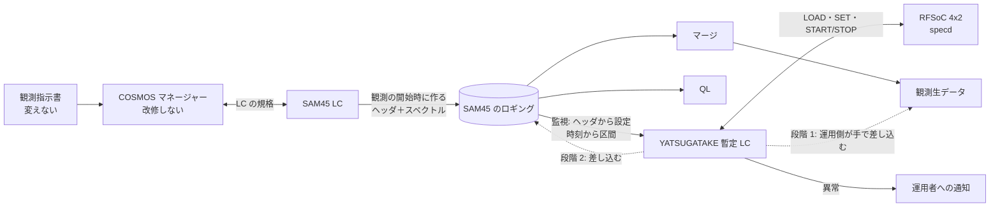

# SAM45 の肩代わりの検討

YATSUGATAKE で SAM45 の故障した Array（A05〜A08、A21〜A24）を肩代わりするための検討と、決めたこと。
既存のシステムの構成（観測指示書 → COSMOS マネージャー → LC → ロギング → QL・マージ）は
[`../cosmos/observation-flow.md`](../cosmos/observation-flow.md) にあり、ここではそれを前提にする。

## 優先度（2026-11-06 決定）

1. **スピード。** SAM45 はすでに故障しているので、できるだけ早く実装を終える。
2. **観測者の手順の変更を最小にする。** 多少の変更（変換スクリプトを手で実行する程度）は許容する。

## 決めたこと

| 項目 | 決定 | 理由 |
|---|---|---|
| マネージャー | **改修しない**（11-06） | 改修には COSMOS 全体の再コンパイルが要り、リスクがある |
| 設定とタイミングの受け取り | **SAM45 のロギングの監視だけで完結させる**（下の b5。11-06、MLPPS の b4 から変更） | ロギングは観測の開始時にでき、ヘッダに分光の設定が全部ある。最初のスペクトルまで ≒ 30 s あり、Overlay の載せ替えに間に合う。観測者の手順も COSMOS も変えずに済む |
| スペクトルの差し込み | **SAM45 のロギングの時刻に合わせて差し込む**（下の c4。11-06） | SAM45 が実際に積分した時刻をそのまま使える |
| 進め方 | **2 段階**。段階 1 は運用側の動作試験、すぐ続けて段階 2 で本番の形にする（11-06） | マージは観測者からアクセスできないので、マージ後の手作業は運用側で回す |
| 積分時間のずれ | **許容する**（11-06） | SAM45 は 40 ms・100 ms、YATSUGATAKE は 10.24 ms の倍数（40.96 ms・102.4 ms）。このずれは科学観測上は問題にならない |
| 積分の当て方 | **YATSUGATAKE は 10.24 ms で記録し、SAM45 の各積分の区間に重なるダンプを束ねて差し込む**（下の t2。11-06） | 区切りのずれが端で ≒ 5 ms に収まる。10.24 ms の記録は差し込み後に削除する |
| 周波数軸 | **差し替える Array の L1 の周波数の欄を YATSUGATAKE の値に書き換える**（下の f2。11-06） | 補間せずに YATSUGATAKE のデータをそのまま正確に使える |
| Wide と Fine の同時 | **できない制約として受け入れる**（11-06） | 肩代わりする Array に 500 MHz 以上と 250 MHz 以下が混ざる観測には対応しない。実際は 250 MHz 以下の組み合わせが多く、実用上は影響しない見通し |
| IFATT | **肩代わりの運用中は、指示書の `iary_ifatt` に何が入っていても 0 として扱う**（下の「値と IFATT」。11-06） | YATSUGATAKE はダイナミックレンジが広く、R でレベルを下げる必要がない |
| 状態の知らせ方 | **暫定 LC のログ＋運用者への通知**（下の「状態の知らせ方」。11-06） | MLPPS をやめたので、COSMOS に状態を返す経路が無い |

## 全体の構成

## 設定とタイミングの受け取り（b5. ロギングの監視）

暫定 LC が SAM45 のロギングの置き場所を監視し、新しいファイルができたら、そのヘッダから故障した Array（A05〜A08、A21〜A24）の分光の設定を読む。観測者の指示書にも COSMOS にも手を入れない。

形式は [`../cosmos/sam45-logging.md`](../cosmos/sam45-logging.md)。

1. **ファイルの生成を見つける**: ロギングはネットワークマウントの上なので、inotify は効かない見込み。**1 s 程度の間隔で見回る**
2. **ヘッダを読む**: L0・L1 はファイルができたとき（ログ ID の時刻）に書かれる。ファイルの大きさが L0 ＋ L1（88 ＋ 8472 B）に達したら、L1 の `iary_usefg`・`dbebw`・`dfqdat_*`・`csid_type` などを読む
3. **設定を YATSUGATAKE に移す**: 必要な bit が今と違えば `LOAD`、続けて `SET`、`START`。bit が同じなら `LOAD` は省く
4. **記録**: tint 10.24 ms で、観測の終わりまで連続で記録する（区切りは t2 で SAM45 の時刻に合わせるので、開始の精度は要らない）
5. **終わりの判定**: ロギングの最後の **`ED` レコード**で判定する

### 準備の時間の予算

**締め切りは最初の R の積分の開始。** ロギングができてから（ログ ID の時刻）、最初の R までに次を終える。
その前の ZERO は固定の値でよいので、分光計がセットアップの途中でも構わない（2026-11-06）。
最短で ≒ 30 s と見込む（サンプルではログ ID から最初の R まで ≒ 8 分あった）。

| 手順 | 見込み |
|---|---|
| ファイルの生成に気づく | ≦ 見回りの間隔（≒ 1 s） |
| ヘッダを読む | 数 s 以下 |
| `LOAD`（bit が変わるときだけ） | 10〜20 s（YATSUGATAKE の specd の LOAD） |
| `SET`・`START`（START は tint の倍数の時刻に置かれる） | 1 s 以下 |

- **30 s のばらつき**（観測のモードで短くならないか）を確かめる。余裕が足りないときは、最初の数積分を差し込めないことを受け入れるか、bit の載せ替えを避ける運用（同じ bit が続く観測をまとめる）を考える
- 実際の時間は段階 1 の試験で測る

### 状態の知らせ方

MLPPS をやめたので、YATSUGATAKE の異常を COSMOS に返す経路は無い。

- 暫定 LC は、異常の時刻と中身を**自分のログ**に残す（どの観測・どの区間が怪しいかを後から追えるように）
- 段階 1: **運用者への通知**（メール・Slack など。手段は決める）と、今の状態を見るコマンドを用意する
- 段階 2: 差し込むデータに異常の印を付ける。L2 の **`idmy_flag`（0 有効・1 無効）** を使う見込み（QL・マージがこの印をどう扱うかは確かめる）

### ほかの案（採らなかった）

| 案 | 中身 | 採らなかった理由 |
|---|---|---|
| b4. MLPPS（11-06 にいったん採用） | 指示書の MLPPS で python を実行し、暫定 LC に設定・ステータスを送る。MLPPS 行は変換スクリプトで挿入 | ロギングのヘッダに設定が全部あるとわかり、要らなくなった。観測者の手順（指示書の変換）が増え、設定を指示書から写す手間と食い違いの心配もあった |
| b1. 中継（proxy） | マネージャーと SAM45 LC の間に中継を置き、命令の写しを YATSUGATAKE 側に渡す | 作る量が多い |
| b2. SAM45 LC から渡す | SAM45 LC を改修し、受けた命令を YATSUGATAKE 側にも渡す | SAM45 LC の改修が要る |
| b3. 装置として足す | YATSUGATAKE 用の LC を装置としてマネージャーに足す | マネージャーの改修（COSMOS 全体の再コンパイル）が要る |

## スペクトルの差し込み（c4）

SAM45 のロギングにある各積分の時刻に対応する YATSUGATAKE のスペクトルを束ねて、故障した Array の分に差し込む。

- YATSUGATAKE は 10.24 ms ごとのスペクトルを、自分の時刻（1PPS・10 MHz に同期）を付けて一時ファイルに記録しておく（下の「時刻と積分」）
- 差し込みが終わったら、一時ファイルを削除する

### 2 段階の進め方

| | 段階 1: 運用側の動作試験 | 段階 2: 本番 |
|---|---|---|
| 設定とタイミング | ロギングの監視（b5） | 同じ |
| 差し込む先 | マージ後の観測生データ | マージ前の SAM45 のロギング |
| 実行 | **運用側**がマージの後に手で差し込みスクリプトを実行する | 暫定 LC が自動で差し込む |
| QL | 故障した Array は出ない | 出る |
| 観測者の手順 | 変えない（差し込みは運用側） | 変えない |
| 目的 | 設定の読み取り・準備の時間・周波数軸・時刻の対応・値のスケールを確かめる。段階 1 ではロギングを**読むだけ**なので、SAM45 の元データは安全 | 観測者から SAM45 が故障していないように見せる |

段階 1 と段階 2 は入口（ロギングの監視）が同じ。差し込みの処理（時刻の対応・周波数軸・スケールの変換）も段階 2 でそのまま使えるように作る。段階 2 で増えるのは、差し込む先と、マージとの競合の回避。

### 段階 2 で解決が要ること

- **マージとの競合**: 観測が終わるとマージがすぐに起動する。それまでに差し込みを終える（または、マージが待つ仕組みを既存の範囲で作れるか確かめる）
- **SAM45 LC との同時書き込み**: SAM45 LC が書いている途中のファイルに手を入れない。ファイルが閉じたことの判定方法
- **元データの保全**: 差し込む前の SAM45 のロギングを残す
- **ファイルの構造**: 故障した Array の区画がロギングにあれば上書き、なければ構造を変える必要がある
- **QL との関係**: 差し込むまでの間、QL には故障した Array の値が見える

### ほかの案（採らなかった）

| 案 | 中身 | 採らなかった理由 |
|---|---|---|
| 開始・終了を MLPPS で送り、YATSUGATAKE が自分で書く | 積分の区切りを MLPPS で伝える | MLPPS の実行時間と逐次の実行で、SAM45 との時刻のずれが入る。OTF ではスキャンごとに行が増える |
| c2. SAM45 LC が受け取って書く | YATSUGATAKE のスペクトルを SAM45 LC に渡す | SAM45 LC の改修が要る |
| c3. マージで差し替える | マージ・QL が差し替える | マージ・QL の改修が要る。マージは観測者からアクセスできない |

## 時刻と積分

### YATSUGATAKE の積分の段

| 段 | 積分の単位 | 出典（YATSUGATAKE リポジトリ） |
|---|---|---|
| PL | **BASE = 10.24 ms**（格子 2.048 ms の 5 倍）ごとにダンプする | `docs/design/sam45-fine/README.md`・`docs/design/sam45-wide/README.md` |
| PS（specd） | PL のダンプを n_sum 個束ねて **tint = BASE の倍数**にする。既定は 40.96 ms（4 × BASE） | `docs/spec/timing.md`・`docs/spec/interface.md` の 5. |

- specd は取得の開始を **T（ボードの時刻）の tint の倍数**に置く。区切りは 1PPS・10 MHz に同期した YATSUGATAKE の時刻の格子に乗り、SAM45 の区切りとは揃わない
- 短い tint の実績（YATSUGATAKE v1.0.0 の性能評価）:
  - SAM45-Fine: **10.24 ms で 30 分、取りこぼし 0**。ただし取得の CPU ≒ 75 % で loop_slow が出る（40.96 ms では 0）
  - SAM45-Wide: **40.96 ms でしか判定していない**
  - ネットワーク: 8 窓 × 4096 ch × float32 で、10.24 ms でも 12.8 MB/s（1 ボードの予算 30 MB/s に入る）

### SAM45 の積分時間との対応

**PSW**: 積分時間は秒の単位（サンプルでは ZERO 1 s、ほか 5 s）で、**1PPS の秒の境界から始まる**（2026-11-06）。
ロギングの時刻（`cint_sttm`・`cint_edtm`・`dint_stmjd`・`dint_edmjd`）は 1 s の分解能だが、秒の境界に乗っているので、そのまま積分の区間として使える。
1 s は 10.24 ms の倍数でないので、区間の両端で 10.24 ms のダンプが半端になる。端のずれは最大 ≒ 5 ms で、5 s の積分に対して 0.1 % 程度。

**OTF など短い積分**: 積分時間 **40 ms・100 ms**。YATSUGATAKE の tint は 10.24 ms の倍数なので、近い値は次のとおり。OTF のロギングの時刻は積分の中心で、ms まで入る。

| SAM45 | YATSUGATAKE の tint | 差 |
|---|---|---|
| 40 ms | 40.96 ms（4 × BASE） | +2.4 % |
| 100 ms | 102.4 ms（10 × BASE） | +2.4 % |

この長さの差は、科学観測上は問題にならないので**許容する**（2026-11-06）。

### SAM45 の 1 積分に YATSUGATAKE のどのスペクトルを当てるか（2026-11-06 決定: t2）

| 案 | YATSUGATAKE の tint | 当て方 | 区切りのずれ | 懸念 |
|---|---|---|---|---|
| t1. SAM45 と同じ長さ | 40.96 ms / 102.4 ms（ヘッダの積分時間に合わせて切り替える） | SAM45 の積分の中心に最も近い 1 つ | 最大で tint の半分（≒ 20 ms / 51 ms） | 区切りの位相が SAM45 と揃わない。OTF では位置のずれになる |
| t2. 短く記録して束ねる | 10.24 ms（または 20.48 ms）で記録 | SAM45 の積分の区間に重なるダンプを差し込みのときに束ねる | 端で最大 BASE の半分（≒ 5 ms）程度 | SAM45-Wide を短い tint で運転した実績がない。データ量が 4 倍（10.24 ms で ≒ 46 GB/時） |

**t2 を採る**（2026-11-06）。
- SAM45 の区間に最も近づけられ、SAM45 の積分時間（40 / 100 ms）に合わせて tint を切り替える必要もない
- YATSUGATAKE は **tint 10.24 ms** で記録する（20.48 ms は、下の試験で 10.24 ms に問題が出たときの代わり）
- 10.24 ms の記録は**一時ファイル**として扱い、差し込み（段階 1 では観測生データ、段階 2 ではロギング）が終わったら削除する。ディスクへの影響は残らない
- **要る試験**: SAM45-Wide を tint 10.24 ms で長時間運転し、取りこぼしがないことを確かめる（SAM45-Fine は 30 分の実績あり。どちらも観測の長さを想定した時間で確かめる）

## SAM45 らしく見せるために合わせるもの

観測生データの中で SAM45 の Array として違和感なく扱われるには、少なくとも次を合わせる必要がある。

- **ch 数・周波数軸**: 下の「周波数軸」
- **時刻と積分**: 上の「時刻と積分」
- **値の大きさ**: 下の「値と IFATT」
- **Tsys**: 下の「Tsys」
- **付随する情報**: L2 のほかの欄（`cary_name`・`cscan_type`・時刻・`dweather` など）は、同じ積分の SAM45 のほかの Array の L2 から写す

### 周波数軸

SAM45 と YATSUGATAKE は、どちらも 4 GSPS で第 2 ナイキストの 2〜4 GHz を入れる。**同じ 2〜4 GHz の IF を分ければ、周波数の変換は要らない**（ただし YATSUGATAKE の fs は 4096 MSPS）。

| SAM45 の帯域（`dbebw`） | YATSUGATAKE の bit と帯域 | ch 間隔（SAM45 / YATSUGATAKE、4096 ch） |
|---|---|---|
| 2000 MHz | SAM45-Wide 2048 MHz（**窓 1 つ**） | 488.3 / 500 kHz |
| 1000 MHz | SAM45-Wide 1024 MHz | 244.1 / 250 kHz |
| 500 MHz | SAM45-Wide 512 MHz | 122.1 / 125 kHz |
| 250 MHz | SAM45-Fine 256 MHz | 61.04 / 62.5 kHz |
| 125 MHz | SAM45-Fine 128 MHz | 30.52 / 31.25 kHz |
| 62.5 MHz | SAM45-Fine 64 MHz | 15.26 / 15.625 kHz |
| 31.25 MHz | SAM45-Fine 32 MHz | 7.629 / 7.8125 kHz |
| 15.625 MHz | SAM45-Fine 16 MHz | 3.815 / 3.906 kHz |

- どの帯域も YATSUGATAKE のほうが 2.4 % 広い（2000 / 2048）。**ch 間隔が SAM45 と一致しない。**
- **f2 を採る**（2026-11-06）: 差し替える Array の **L1 の周波数の欄を YATSUGATAKE の値に書き換える**。スペクトルは補間しない
  - 書き換える欄の候補: `dbebw`・`dbechwid`・`dberes`・`dfqdat_f0`・`dfqdat_fq`・`dfqdat_ch`（`dcent_freq`・`dtrk_freq` は観測の指定なので変えない見込み）。どの欄をマージ・QL が使っているかを確かめて決める
  - 窓の中心は SAM45 の指定（`dfqdat_f0` など）に合わせ、YATSUGATAKE の窓を置く。YATSUGATAKE の窓の中心は格子（Fine は NCO の分解能、Wide は 125 kHz の ch）に寄るので、寄せた後の実際の値で L1 を書く
  - 採らなかった案 f1: YATSUGATAKE のスペクトルを SAM45 の ch の格子に補間し直す（L1 はそのままだが、分解能と雑音の ch 間の相関が変わる）
- **Wide と Fine は同時に使えない**（別の bit）。1 つの観測で肩代わりする Array に 500 MHz 以上と 250 MHz 以下が混ざるときは、肩代わりできない制約として受け入れる（2026-11-06）。そのときは **250 MHz 以下の Array を取り**、取れない Array は **`idmy_flag` = 1 で差し込み、運用者に知らせる**（2026-11-06）
- SAM45 は ch が増えると周波数が下がる向き（サンプルの USB）。YATSUGATAKE の ch の向きとの対応を合わせる

### 値と IFATT

- SAM45 の ADC は 3 bit でダイナミックレンジが狭いので、R のときに IFATT（`iary_ifatt` dB）を足してレベルを下げている
- YATSUGATAKE はダイナミックレンジが広いので、R でレベルを下げる必要はない。R の値は SKY より大きくなる
- **肩代わりの運用中は、指示書の `iary_ifatt` に何が入っていても、YATSUGATAKE 暫定 LC は 0 として扱う**（2026-11-06）。観測者の手順は変えない
- **物理の IFATT は YATSUGATAKE の経路にも入る**（2026-11-06）:
  - SKY でのレベル合わせは今までどおり行う（SKY・R に同じだけ効くので、較正には影響しない）
  - **IFATT の制御プログラムを改修し、IF 入力 5〜8（A05〜A08・A21〜A24）では R のときの ATT の追加を無視する**（2026-11-06 の予定）。これで YATSUGATAKE の R は減衰しないので、数値で戻す処理は要らない
- **L1 の `iary_ifatt` も 0 に書き換える**（2026-11-06）: QL・マージは `iary_ifatt` を Tsys と強度の計算に使う。L1 が指示書の値（例 5 dB）のままだと、減衰していない YATSUGATAKE の R に補正がかかってしまう。f2 で L1 を書き換えるのと同じ処理で、差し替える Array の `iary_ifatt` を 0 にする
- SKY のレベル合わせは SAM45（3 bit）に合わせた値になる。そのときの RFSoC の入力のレベルが、YATSUGATAKE に適した範囲（R でも飽和しない、量子化の雑音が効かない）に入るかを確かめる
- 値の絶対的なスケール（SAM45 の数え方に合わせるか）は、強度の較正（R・SKY）で相殺される。合わせる必要があるのは QL の表示の都合くらい
- ZERO は固定の値でよい（2026-11-06）。SAM45 と同じ 8192 を入れる

### Tsys

- `dtsys` は SAM45 LC が R・SKY から計算して L2 に書き、QL・マージが参考値として表示する（2026-11-06）
- 肩代わりする Array では、YATSUGATAKE の R・SKY から計算して書けるとよい（必須ではない）。SAM45 LC の計算式（IFATT の補正、温度に何を使うか）を確かめる

## ハードウェアの前提

- 故障した Array に入っていた IF 入力 5〜8 を、RFSoC の ADC_A〜D に入れ直す（分岐するか、つなぎ替えるか）
- SAM45 の入力も 2〜4 GHz（第 2 ナイキスト）なので、**周波数の変換は要らない**（2026-11-06）
- 10 MHz・1PPS を SAM45 と同じ基準からとる

## 未確認のこと

答えがわかったら、既存のシステムについての事実は [`../cosmos/`](../cosmos/) に、
そこから決めたことはこのファイルの上の節に書く。

### ロギング
- [ ] 観測の途中で分光の設定が変わることはあるか（L1 だけで 1 観測の設定が決まるか）
- [ ] ログ ID から最初の R までの時間の最短（観測のモードで短くならないか）
- [ ] 暫定 LC を動かす計算機から、ロギングのネットワークマウントを読めるか（段階 1）・書けるか（段階 2）
- [ ] SAM45 LC がファイルを書く順と、書き足しのタイミング（積分ごとに L2 を書き足すか、段階 2 で差し込む時機に効く）
- [ ] QL・マージが `idmy_flag` をどう扱うか（段階 2）
- [ ] 観測の終了からマージの起動までの間隔（段階 2）
- [ ] QL がロギングを読むタイミング（段階 2）

### 観測生データ（段階 1 に必要）
- [ ] マージが作る観測生データの形式。Array ごとのスペクトルはどう入るか

### SAM45 の仕様
- [ ] f2 で書き換える L1 の欄（マージ・QL が周波数軸の計算に使う欄はどれか）
- [ ] `istart_chan`・`iend_chan`（524,288 ch の番号）と IF 周波数の対応、窓の中心の決め方
- [ ] SKY でレベルを合わせた IFATT のときの RFSoC の入力のレベル（YATSUGATAKE に適した範囲か）
- [ ] SAM45 LC の Tsys の計算式
- [ ] OTF のロギング（時刻・`diptim`・40 / 100 ms の対応）。サンプルが要る
- [ ] 故障した Array は今どういう状態か（ロギングに L2 が出るのか、出るなら値は何か）

### ハードウェアと運用
- [ ] IF の分け方（IF 入力 5〜8 を SAM45 の前で分岐するか、つなぎ替えるか）
- [ ] RFSoC と暫定 LC の置き場所と、COSMOS のネットワークへのつなぎ方
- [ ] 運用者への通知の手段

### 解決したこと
- [x] SAM45 の積分時間 → 40 ms・100 ms（OTF など）。PSW は秒の単位で、1PPS の秒の境界から始まる（2026-11-06）
- [x] マネージャーを改修できるか → 再コンパイルが要りリスクがあるので避ける（2026-11-06）
- [x] 分光の設定をどこから得るか → ロギングの L1 に全部ある。ロギングはログ ID の時刻にでき、L0・L1 がそのとき書かれる（2026-11-06）
- [x] 準備の締め切り → 最初の R の積分の開始。ZERO は固定の値でよい（2026-11-06）
- [x] MLPPS の動き → MLPPS を使わないことにしたので調べない（2026-11-06）
- [x] ロギングの形式・ファイルの単位 → 1 観測 1 ファイル、L0・L1・L2 × n・ED（[`../cosmos/sam45-logging.md`](../cosmos/sam45-logging.md)。2026-11-06）
- [x] 観測の終わりの判定 → `ED` レコード（2026-11-06）
- [x] 異常の印の欄 → L2 の `idmy_flag`（2026-11-06）
- [x] スペクトルの値 → float32 × 4096。ZERO は 8192 で一定、R は IFATT の分だけ下がっている（2026-11-06）
- [x] IF の周波数帯 → SAM45 も 2〜4 GHz（第 2 ナイキスト）を入れるので、変換は要らない（2026-11-06）
- [x] SAM45 の積分の時刻 → PSW は秒の境界、ロギングの時刻は 1 s の分解能（OTF は中心の時刻で ms まで）（2026-11-06）
- [x] 比べる基準 → サンプルの A05・A06 は故障前のデータ（2026-11-06）
- [x] 周波数軸の合わせ方 → f2（L1 の周波数の欄を書き換える）（2026-11-06）
- [x] Wide と Fine が混ざる観測 → 対応しない制約として受け入れる。実用上は 250 MHz 以下が多い（2026-11-06）
- [x] `iary_ifatt` → 指示書の値によらず 0 として扱い、L1 も 0 に書き換える（2026-11-06）
- [x] 物理の IFATT → YATSUGATAKE の経路にも入る。SKY のレベル合わせは行い、IFATT の制御プログラムを改修して IF 入力 5〜8 では R の ATT を足さない（2026-11-06）
